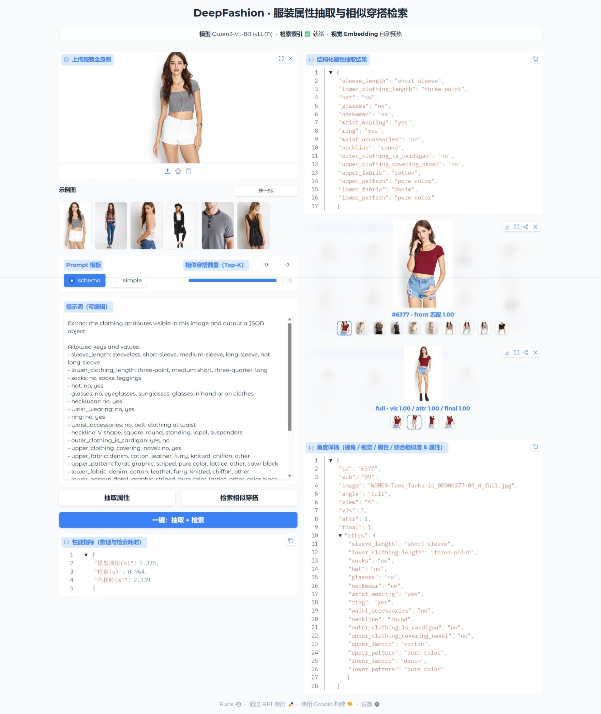

# vlm-sft —— Qwen3-VL 服装属性抽取 LoRA 微调

> **主线**：基于 Qwen3-VL-8B-Instruct，对 DeepFashion-MultiModal（4.4 万图、18 维官方标注属性）做 LoRA 微调，实现「服装全身图 → 结构化属性 JSON」抽取（schema 感知指令 + 自建评测体系），并在此基础上落地**全库相似款检索推荐**，形成「电商标注 + 相似款推荐」完整闭环。

**核心成果**（test 集 4,410 张未见图，基座 0-shot vs LoRA 微调）：

| 指标 | 基座 | LoRA | 提升 |
|---|---|---|---|
| 属性级准确率 | 59.8% | **93.8%** | **+34.0pp** |
| macro-F1 | 0.417 | **0.677** | +0.260 |
| 全 JSON 精确匹配率 | 0.0% | **47.3%** | +47.3pp |
| JSON 可解析率 | 100% | **100%** | — |

- 18 个属性全部通过 McNemar 显著性检验（p<0.001）；
- 消融证明 **schema 感知指令是决定性方法**（同数据下比朴素指令 +31.5pp）、训练无过拟合、推理对分辨率鲁棒；

## 效果演示



📄 **文档**：[技术方案与实验报告](docs/DeepFashion技术方案与实验报告.md)（主文档）｜ [检索/推荐闭环说明](docs/检索推荐说明.md) ｜ [部署说明](docs/部署说明.md) ｜ [数据说明](docs/数据说明.md) ｜ [调参说明](docs/调参说明.md)

---

## 仓库结构

```
vlm/
├── data/ -> /disk16T1/scratch/maotai/data/vlm_data   # 数据集（软链）
├── docs/                   # 主文档（方案+实验报告）+ 检索方案 + 运维手册 + archive/ 归档
├── llamafactory/           # 工作文件夹（训练配置、评测产物、模型权重）
├── requirements_lf_full.txt # lf 环境依赖（pip freeze 全量精确版，可直接复现）
└── scripts/                # 数据转换 / 评测打分 / 报告生成 / 部署脚本
```

---

## 各文件夹说明

### data/
数据集目录，**软链**到 `/disk16T1/scratch/maotai/data/vlm_data`，**已被 git 忽略**。内部按「原始数据 / 转换后数据」组织，详细说明见 docs/ 下的《数据说明》文档。

### docs/
项目文档（主文档 + 实现说明 + 运维手册 + 归档）：

- `DeepFashion技术方案与实验报告.md`：**主文档**——技术方案 + 实验报告合稿（背景、数据、方法、评测、结果论证链、badcase、检索闭环、部署、复现），投递/答辩/复盘都用这一份。
- `检索推荐说明.md`：**实现说明**——图 → 属性 → 全库相似款检索闭环（检索管线、工程纪律、落地产物）。
- `部署说明.md`：**服务化部署手册**——环境准备、单卡/多卡（TP=2 + 128k）启动、OpenAI 兼容 API、Gradio Web 页面、踩坑记录。
- `数据说明.md`：数据转换与 LLaMA-Factory 接入，**含 18 维属性对照表（唯一权威属性来源）**。
- `调参说明.md`：训练超参与调参经验记录。
- `archive/`：**历史归档**——旧版 `DeepFashion微调项目方案.md`、`DeepFashion微调技术报告.md`（内容已并入主文档，仅作保留）。

### llamafactory/（工作文件夹）
日常训练工作都在这：训练配置、模型权重、评测产物。

- `config/`：训练/评测/导出配置——`qwen3vl8b_dfattr_train*.yaml`（DeepFashion 主线训练）、`qwen3vl8b_dfattr_eval_val_*.yaml`（val 评测，含 few-shot / simple-prompt / 压缩分辨率变体）、`qwen3vl8b_dfattr_eval_test_*.yaml`（test 最终评测）、`qwen3vl8b_dfattr_export_cli.yaml`（导出合并）；子目录 `ablation/`（指令范式消融）、`ckpt_screen/`（checkpoint 快筛，配置由脚本生成）。
- `saves/`：模型权重与训练/调度日志（**git 忽略**）——主线 `dfattr/`（LoRA + merged）、早期实验 `v1/ v2/`、消融 `ablation/`、checkpoint 快筛 `ckpt_screen/`。
- `eval_outputs/`：评测生成预测（`generated_predictions.jsonl` 等），按实验分目录（`val_base/`、`val_lora/`、`test_*`、`ablate_*`、`ckpt_screen/`、few-shot/simple-prompt/压缩分辨率变体）。
- `results/`：评测汇总产物（`preds_*.jsonl`、`report_*.md` 评测报告、`data_stats.json`）与评测日志（`eval_*.log`）；`report_*.md` 由 `scripts/summarize_*.py` 生成，`report_val.md`/`report_test.md` 由 `eval_attr.py stats` 生成。

### scripts/
数据转换 / 评测打分 / 报告生成 / 部署脚本：

- `data_convert_deepfashion_multi.py`：DeepFashion-MultiModal → LLaMA-Factory 训练格式（主线 schema 版 + simple 对照 + 描述 + 属性 QA）。
- `data_convert_fewshot_val.py`：生成 few-shot 评测数据（schema 指令 + 2 个文本示例）。
- `check_data.py`：DeepFashion 数据质量四关卡（结构/答案/防泄漏/分布）。
- `eval_attr.py`：评测打分 `stats`（属性级 acc / macro-F1 / 分层 / McNemar，容错解析）；预测生成走 llamafactory 管线。
- `convert_preds.py`：把 llamafactory 预测输出（`generated_predictions.jsonl`）转为 `eval_attr.py stats` 可消费格式。
- `summarize_ablation.py` / `summarize_category.py` / `summarize_ckpts.py` / `summarize_confirm.py` / `summarize_resolution.py` / `summarize_supplement.py`：报告生成（分别对应消融、品类分层、checkpoint 快筛/确认、分辨率、补充实验报告）。
- `serve_demo.py`：DeepFashion 部署 demo 客户端（CLI，vLLM OpenAI 兼容）。
- `serve_gradio.py`：DeepFashion 部署 Web 页面（Gradio，模板切换 + prompt 手动编辑，浏览器传图看结构化 JSON + **相似款检索**）。
- `build_retrieval_index.py`：构建检索索引（官方标注聚合 + 冻结视觉塔抽 embedding）→ `data/.../retrieval/index_vectors.npy` + `index_meta.json`。
- `retrieval.py`：相似款检索（视觉余弦 + 官方属性命中率混合加权，top-k + 同款排重），含库内自检。
- `start_vllm.sh`：vLLM 一键启动脚本（封装 CUDA_HOME / flashinfer 禁用等环境准备，支持单卡/多卡切换）。
- `start_web.sh`：**Web demo 一键启动**（vLLM + Gradio 全自动：环境准备、GPU 分卡避让、健康检查、日志、`--stop`/`--status`）。

### 根目录文件
- `requirements_lf_full.txt`：lf 环境全量依赖（pip freeze 精确版本，`pip install -r` 可直接复现环境）。

---

## 环境

项目用 conda 管理两套隔离环境：

| 环境名 | 用途 | 依赖 |
|---|---|---|
| `lf` | LLaMA-Factory 微调/评测（主线） | `requirements_lf_full.txt`（pip freeze 全量精确版） |
| `vllm` | 部署（克隆自 lf + `pip install vllm`，不污染训练环境） | 复现步骤见 `docs/部署说明.md` §2 |

> `vllm` 环境无独立依赖文件，按部署说明 §2 克隆 lf 后安装 vllm 0.27.1 + 升级 flashinfer 即可。

### 模型与路径约定

仓库内路径均为**相对路径**（在仓库根运行即可），不含任何本机绝对路径：

| 项 | 约定 |
|---|---|
| 仓库内数据/产物路径 | 相对仓库根（`data/`、`llamafactory/eval_outputs/` 等），直接可用 |
| 基座模型 | 放到 `models/Qwen3-VL-8B-Instruct`（全部训练/评测/导出配置中 `model_name_or_path` 均写此相对路径，在仓库根运行即按本地目录加载） |

> **注意**：本仓库 llamafactory 的 CLI 用 `OmegaConf.to_container` 读配置，**不解析 `${oc.env:...}` 插值**（OmegaConf 2.3.x 的 `to_container` 默认不 resolve 插值，`${oc.env:LLM_MODEL_PATH, ...}` 会原样传给 HF 导致启动失败），因此配置中**直接写相对路径**、不要用插值写法；换机/发布时把模型软链到仓库 `models/Qwen3-VL-8B-Instruct` 即可（`grep -rn "model_name_or_path" llamafactory/config` 可找到全部位置）。
